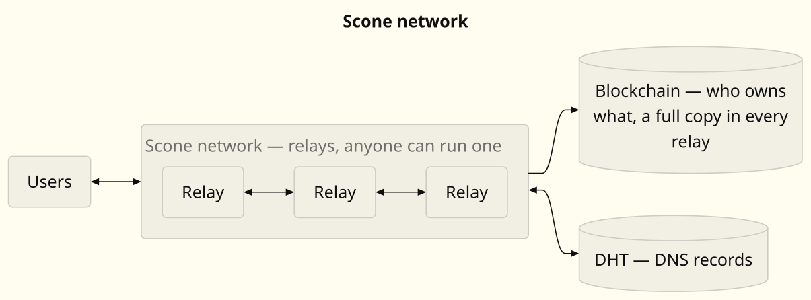

# Scone documentation

The documentation is **multilingual** and **normative**: it must enable an
independent implementation without reading the Rust code. Any
doc/code divergence is a bug (identify the source of truth, fix it).

- [`en/`](en/README.md)
- [`zh-hans/`](zh-hans/README.md)
- [`zh-hant/`](zh-hant/README.md)
- [`es/`](es/README.md)
- [`hi/`](hi/README.md)
- [`ar/`](ar/README.md)
- [`pt/`](pt/README.md)
- [`ru/`](ru/README.md)
- [`fr/`](fr/README.md)
- [`de/`](de/README.md)
- [`ja/`](ja/README.md)
- [`id/`](id/README.md)
- [`vi/`](vi/README.md)
- [`bn/`](bn/README.md)
- [`ur/`](ur/README.md)

Each language tree mirrors the same structure:

- **`general/`** — how it works: protocol concepts and rules,
  readable without the binary-format details;
- **`technical/`** — developer specifications: exact binary formats,
  hash formulas, bounds, APIs and per-component behaviour.

The two trees are kept in sync: a change in one must be mirrored in
the other (same file names).
